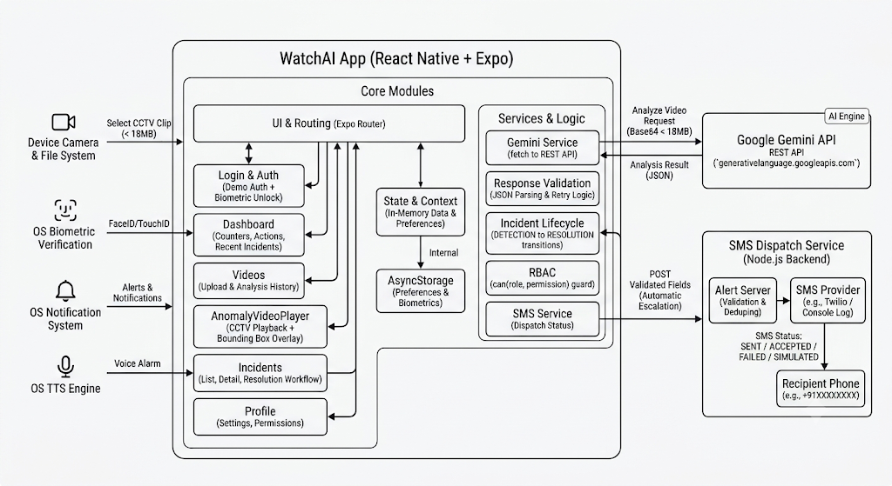

# WatchAI

AI-powered industrial safety monitoring: a React Native + Expo app plus a tiny SMS dispatch service.

A safety officer signs in, unlocks with biometrics, picks a recorded CCTV clip from the device, sends it
to Google Gemini for safety analysis, and works the resulting incidents through notification, voice
alarm, SMS escalation, human review and resolution.

---

## Stack

React Native 0.81 · Expo (SDK 54) · NodeJS · TypeScript · Expo Router 6 · Google Gemini API · Postgres

---

## Getting started

```bash
npm install
cp .env.example .env      # then paste your Gemini key
npx expo start
```

`.env`:

```env
EXPO_PUBLIC_GEMINI_API_KEY=your_key_here
EXPO_PUBLIC_EMERGENCY_CONTACT=+91XXXXXXXXXX
EXPO_PUBLIC_GEMINI_MODEL=            # optional, see below
```

Restart Expo after editing `.env` — `EXPO_PUBLIC_*` values are inlined at bundle time.

## Demo Video

https://drive.google.com/file/d/1ZkcEQYjio4ZrsGjP9tT12enaI9B9O6gH/view?usp=sharing

## Architecture



```
app/
├── _layout.tsx              providers, root stack, always-mounted critical alert
├── index.tsx                entry gate: login / unlock / dashboard
├── (auth)/login.tsx         demo authentication
├── (auth)/biometric.tsx     enrol on first login, unlock on later launches
└── (app)/
    ├── _layout.tsx          tab navigator + auth guard + RBAC-gated tabs
    ├── dashboard.tsx        counters, actions, recent incidents & alerts
    ├── videos/index.tsx     AI engine status + analysis history
    ├── videos/upload.tsx    select → verify → analyse → results
    ├── incidents/index.tsx  filters, newest first
    ├── incidents/[id].tsx   full detail + permitted actions
    ├── alerts.tsx           critical / high / medium / general lanes
    └── profile.tsx          role, permissions, biometrics, notifications, SMS contact
components/  services/  context/  hooks/  constants/  types/  lib/
```

### RBAC

`constants/roles.ts` and `constants/permissions.ts` hold the roles, the permission list and the
`can(role, permission)` helper. Every gate in the app goes through `can()` — role checks are not
scattered through screens, and a control the current role cannot use is not rendered at all.

| | ADMIN | SAFETY_OFFICER | SUPERVISOR | VIEWER |
| --- | :-: | :-: | :-: | :-: |
| VIEW_DASHBOARD | ✓ | ✓ | ✓ | ✓ |
| UPLOAD_VIDEO | ✓ | ✓ | | |
| ANALYZE_VIDEO | ✓ | ✓ | | |
| VIEW_INCIDENT | ✓ | ✓ | ✓ | ✓ |
| SEND_SMS | ✓ | ✓ | | |
| REVIEW_INCIDENT | ✓ | ✓ | ✓ | |
| RESOLVE_INCIDENT | ✓ | ✓ | ✓ | |

### Gemini response validation

Model output is never trusted as-is (`services/geminiService.ts`):

- the response is JSON-parsed after stripping any stray fencing or prose;
- `analysis_status` must be one of `SUCCESS | NO_INCIDENT | UNCERTAIN | FAILED`;
- `summary` must be present, and `incidents` must be an array;
- each incident needs a recognised `incident_type`, a valid `severity` and a usable `description`;
- `confidence` must land in `0.0–1.0` (a `1–100` value is read as a percentage; anything else is rejected);
- `timestamp` must match `MM:SS` — an unusable one renders as `—` rather than being invented;
- `box_2d` must be four numbers describing a non-degenerate, in-range box, or the region is dropped;
- `SUCCESS` with no usable incident is treated as a validation failure.

### Incident lifecycle

`DETECTED → ACKNOWLEDGED → REVIEWED → RESOLVED`, plus `DETECTED → REJECTED`. Transitions live in
`lib/incidentFlow.ts`; a button appears only when the transition is legal *and* the role permits it.

---

## Playback with anomaly localisation

The analysed clip plays inside the app, with Gemini's bounding box drawn over the anomalous region.

Alongside each incident, the model returns `box_2d` as `[ymin, xmin, ymax, xmax]` normalised to
0-1000 with the origin at the top-left of the frame. `normalizeBoundingBox` in
[services/geminiService.ts](services/geminiService.ts) converts that to fractions of the frame and
**rejects** anything malformed, inverted, out of range, or covering essentially the whole frame — a
box is dropped rather than drawn in the wrong place, and never synthesised.

[components/AnomalyVideoPlayer.tsx](components/AnomalyVideoPlayer.tsx) draws it:

- The overlay maps fractions onto the **letterboxed rect** the video actually occupies, computed from
  `player.videoTrack.size`, so boxes stay aligned whatever the clip's aspect ratio.
- A box appears while playback is within **1.5s** of the incident timestamp, and stays pinned when you
  jump to it.
- Tap a timestamp chip to seek straight to that moment; the box is colour-coded by severity and
  labelled with type and confidence.
- The overlay is `pointerEvents="none"`, so the native video controls still work.

It appears on **Analyse Footage** after a run, and on **incident detail** for any incident whose clip
is still on the device (seeked to the incident automatically).

---

## Automatic SMS escalation

By default a **CRITICAL** incident is texted to the emergency contact immediately — no confirmation, no
composer. The flow:

```
Incident created (Gemini or demo mode)
        ↓
severity >= EXPO_PUBLIC_AUTO_SMS_MIN_SEVERITY  (default CRITICAL)
        ↓
POST validated fields -> alert server -> SMS provider
        ↓
Live status on the critical alert screen:
  SENDING → SENT / ACCEPTED BY CARRIER / SIMULATED (DRY RUN) / FAILED
```